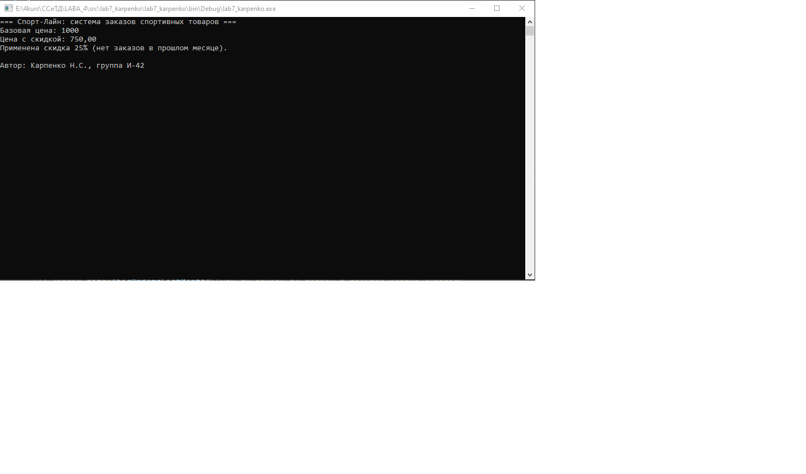
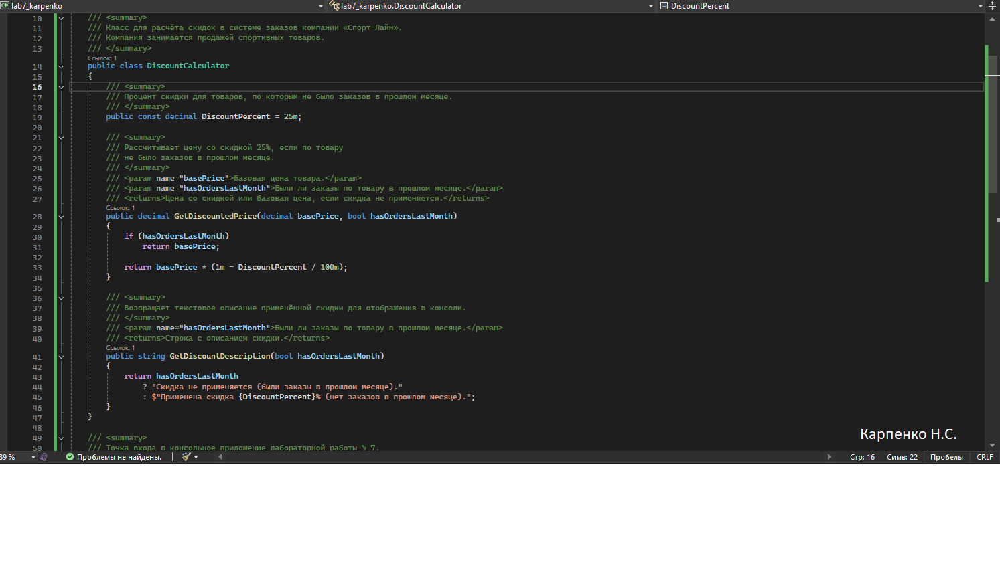
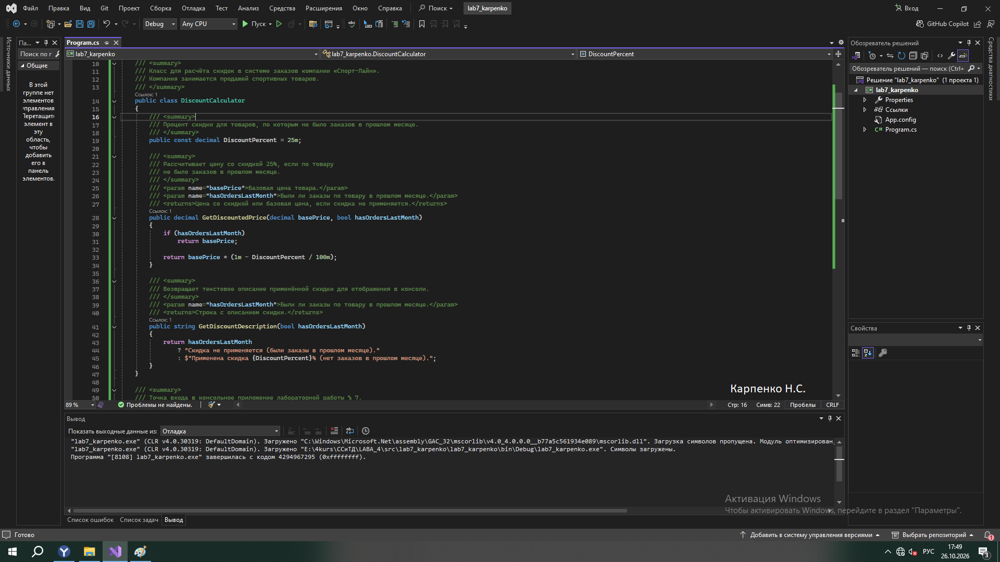

# Система заказов компании «Спорт-Лайн»

**Автор:** Карпенко Н.С., группа И-42  
**Дисциплина:** Стандартизация, сертификация и техническое документирование  
**Лабораторная работа № 7:** Техническое документирование программного проекта: README.md, XML-комментарии

---

## Что делает программа

- Рассчитывает цену со скидкой **25%** для товаров, по которым не было заказов в прошлом месяце.
- Если заказы в прошлом месяце были — возвращает базовую цену без изменений.
- Выводит в консоль базовую цену, цену со скидкой и описание применённой скидки.
- Выводит фамилию автора и номер группы.
- Демонстрирует работу метода `GetDiscountedPrice` класса `DiscountCalculator`.

---

## Как запустить

1. Открыть файл `src/lab7_karpenko/lab7_karpenko.sln` в **Visual Studio**.
2. Нажать **F5** (или кнопку Run).
3. В консоли появится результат расчёта.

---

## Скриншоты

### Скриншот 1: Результат работы программы

### Скриншот 2: XML-комментарии в коде

### Скриншот 3: Среда разработки
